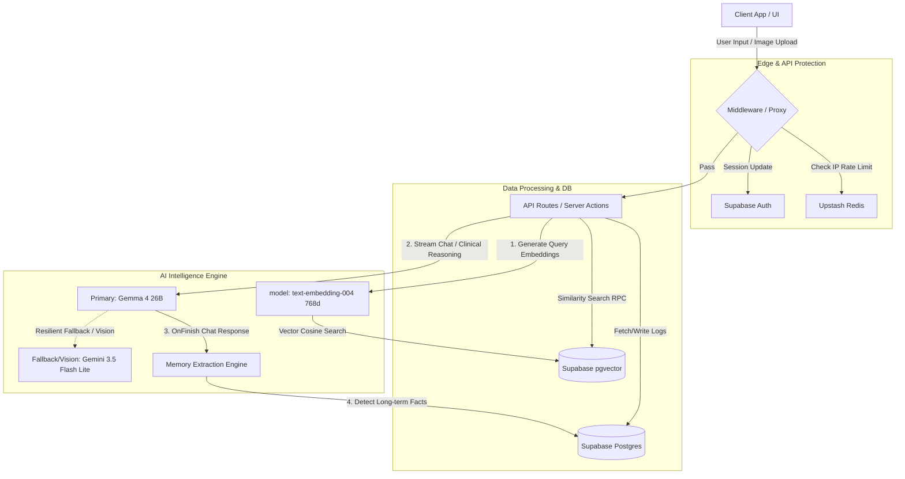

# Agent Baymax 🤖🩺

> **"Hello. I am Baymax, your personal healthcare companion."**  
> An AI-powered companion designed to monitor physical profiles, analyze meals via multimodal AI, plan nutrition, and enforce hydration habits to optimize daily well-being.

---

## 🌟 Pitch Deck: Why Agent Baymax?

Traditional health tracking is static, tedious, and manual. Users get bored of typing ingredient logs, calculating macros, or answering static surveys. **Agent Baymax** transforms self-care by pairing a comforting, empathetic personal companion with a state-of-the-art AI engineering architecture. 

### Key Value Propositions
* **Zero-Friction Vision Logging**: Snap a picture of your meal, and let Baymax handle portion estimation, macro identification, and calorie calculations instantly.
* **Smart Hydration Assistant**: Tracks liquid balance levels using dynamic SVG completion rings, clinical hydration status indicators, and automatically scales daily targets with a workout-day toggle.
* **Medically Grounded RAG**: grounding Baymax's suggestions in verified health guides uploaded by admins and searched in real-time using high-speed vector retrieval.
* **Empathetic Continuity & Memory**: Asynchronously parses chat logs to build a long-term memory profile (allergies, preferences) so future advice is completely personalized.
* **Interactive AI Diet Planner**: Generates complete 7-day meal timelines utilizing body parameters, allergies, and toggled diet preferences (**Veg / Non-Veg / Mix**) with a silent PDF downloader.

---

## 🏗️ Technical Architecture & Core Workflows

Agent Baymax is engineered with a modular, scalable architecture combining edge protection, real-time streaming, and background state synchronization.



---

## 🧠 Core Subsystems

### 1. Dynamic Mifflin-St Jeor Health Engine
Calculates the user's Basal Metabolic Rate (BMR) and Total Daily Energy Expenditure (TDEE) dynamically as physical metrics evolve:
* **Male**: $BMR = 10 \times \text{weight (kg)} + 6.25 \times \text{height (cm)} - 5 \times \text{age (yrs)} + 5$
* **Female**: $BMR = 10 \times \text{weight (kg)} + 6.25 \times \text{height (cm)} - 5 \times \text{age (yrs)} - 161$
* **Macro Allocations & Goal Adjustments**: Target calories and macro goals are dynamically customized based on the user's chosen health journey:
  * **Lose Weight**: Target calories are adjusted to a safe daily deficit (-500 kcal). Protein is boosted to **2.0g per kg** of body weight, and fat is adjusted to **20%** of target energy.
  * **Build Muscle**: Target calories are set to a gentle surplus (+300 kcal). Protein is boosted to **2.2g per kg**, and fat is set to **25%** of target energy.
  * **Maintain**: Calorie targets match TDEE. Protein is set to **1.8g per kg**, and fat is set to **25%** of target energy.
  * *Note: Carbs dynamically fill the remaining daily energy budget.*

### 2. AI-Powered Hydration Assistant
* **Dynamic Ring & Status Tracking**: Displays daily water consumption levels using SVG completion gauges and status badges (`🟢 Excellent`, `🟡 Good`, `🟠 Behind Schedule`, `🔴 Dehydrated`).
* **Workout Day Target Multipliers**: Toggling workout day recalculates targets (adding +800ml for sweat recovery) and writes updates back to the Supabase database.
* **Achievements & Trends**: Logs consumption times in a vertical chronological grid with deletion support, rendering averages, best/worst days on a Recharts graph, and streak achievements.

### 3. AI Diet Planner & Direct PDF Exporter
* **Custom Diet Planner**: Powered by **Gemma 4 26B** (`models/gemma-4-26b-a4b-it`) with automatic resilient fallback to **Gemini 3.5 Flash Lite** (`models/gemini-3.5-flash-lite`). Generates personalized 7-day meal timelines utilizing body parameters, allergies, and toggled diet preferences (**Veg / Non-Veg / Mix**).
* **Future-Ready Workspace Panel**: Groups plan timelines, aggregated grocery ingredient checkers, weekly locks, cooking instructions, and an interactive AI Shopping Assistant.
* **Bypassed PDF Exporter**: Instantly generates styled medical PDF documents client-side using `jsPDF` canvas rendering, bypassing browser print preview dialog windows.

### 4. Interactive Health Dashboard
* **Dynamic Journey Alerts**: Renders weekly caloric and water intake against visual goal lines. Includes a custom, context-aware coaching banner displaying warnings/guidance tailored to the user's specific health goals.
* **Goal Progress Widget**: Shows starting weight, current weight, target weight, body mass index (BMI) status indicator, and weeks timeline estimation.
* **Macro Completion Progress**: Displays daily percentage progress toward hitting total macro targets, scaled with smart color logic (Red for `<30%` completed, Orange for `30% - 70%` completed, and Green for `>70%`).

### 5. Multimodal Vision & Meal Analyzer
* **Multimodal Vision**: Powered by **Gemini 3.5 Flash Lite** (`models/gemini-3.5-flash-lite`) via Vercel AI SDK's `generateObject` for rapid multimodal image recognition, portion estimation, and macro calculation.
* **Clinical Health Companion Advice**: Coached with **Gemma 4 26B** (`models/gemma-4-26b-a4b-it`) for empathetic, medically grounded clinical advice in the voice of Baymax.
* **Integrated Visual Chatting**: Users can upload image attachments directly inside the main chat interface. The chat controller parses the image, estimates calories/macros, automatically commits the meal log entry to the Postgres database, and references the logged food in real-time inside the conversational feed using friendly, warm health tips.

---

## 🗄️ Database Schema Layout

The database runs on Supabase (Postgres) with the following relational layout:

| Table Name | Primary Key | Description | Relationships |
| :--- | :--- | :--- | :--- |
| **`profiles`** | `id` (UUID) | Stores user identity, metadata, and timezone. | Identifies auth.users |
| **`health_goals`** | `id` (UUID) | Stores weight metrics, target calories, BMR, TDEE, macros, starting weight, and AI coach summaries. | Unique per `profiles.id` |
| **`water_logs`** | `id` (UUID) | Stores logged water amounts (ml) and exact timestamp. | Reference to `profiles.id` |
| **`nutrition_logs`** | `id` (UUID) | Stores logged meal foods, types, calorie bounds, and macros. | Reference to `profiles.id` |
| **`meal_analysis`** | `id` (UUID) | Stores AI generated feedback, health score, and uploaded photo URL. | Reference to `nutrition_logs.id` |
| **`agent_memory`** | `id` (UUID) | Stores extracted long-term memories (allergies, preferences) grouped by category. | Reference to `profiles.id` |
| **`knowledge_documents`**| `id` (UUID) | Stores metadata of admin-uploaded reference documents. | - |
| **`document_chunks`** | `id` (UUID) | Stores document text segments and corresponding `vector` embeddings. | Reference to `knowledge_documents.id` |

---

## 🛠️ Technology Stack

* **Frontend**: Next.js 16.2 App Router, React 19, Framer Motion
* **Styling**: Tailwind CSS v4, custom glassmorphic utilities, and Lucide icons
* **Database & Vector Store**: Supabase (PostgreSQL with `pgvector` & `vector` extension)
* **AI & LLM Architecture**:
  * **Primary Model**: Gemma 4 26B (`models/gemma-4-26b-a4b-it`) for empathetic health reasoning, clinical analysis, and personalized diet generation.
  * **Fallback & Multimodal Vision**: Gemini 3.5 Flash Lite (`models/gemini-3.5-flash-lite`) for rapid multimodal meal image recognition and resilient structured fallback.
  * **Vector Embeddings**: `text-embedding-004` (768-dimensional output) integrated with Supabase `pgvector` for verified medical RAG semantic search.
  * **SDKs**: Vercel AI SDK (`ai` and `@ai-sdk/google`) & Google Gen AI SDK (`@google/genai`)
* **Caching & Rate Limiting**: Upstash Redis (sliding window rate limiters)

---

## 🚀 Getting Started

### Prerequisites
* Node.js (v20+ recommended)
* A Supabase account and database instance
* A Google Gemini API Key
* An Upstash Redis database

### 1. Installation
Clone the repository and install project dependencies:
```bash
git clone https://github.com/Harshitagarwal113/Agent-Baymax-V2
cd Agent-Baymax-V2
npm install
```

### 2. Environment Variables
Create a `.env.local` file in the root directory:
```env
# Supabase Configuration
NEXT_PUBLIC_SUPABASE_URL=your-supabase-url
NEXT_PUBLIC_SUPABASE_ANON_KEY=your-supabase-anon-key

# Google Gemini API Configuration
GEMINI_API_KEY=your-gemini-api-key

# Upstash Redis (Rate Limiting)
KV_REST_API_URL=your-upstash-redis-rest-url
KV_REST_API_TOKEN=your-upstash-redis-rest-token

# Callback Settings
NEXT_PUBLIC_SITE_URL=http://localhost:3000
```

### 3. Database Initialization
Run the initialization scripts found in `supabase/init_database.sql` inside your Supabase SQL editor. This sets up:
* Row Level Security (RLS) policies
* Automated triggers to sync user signups to user profile records
* pgvector structures, indices, and the cosine similarity search function (`match_document_chunks`)
* Buckets for food image uploads

### 4. Running Locally
Run the development server:
```bash
npm run dev
```
Open [http://localhost:3000](http://localhost:3000) to start your healthcare companion journey!

---
